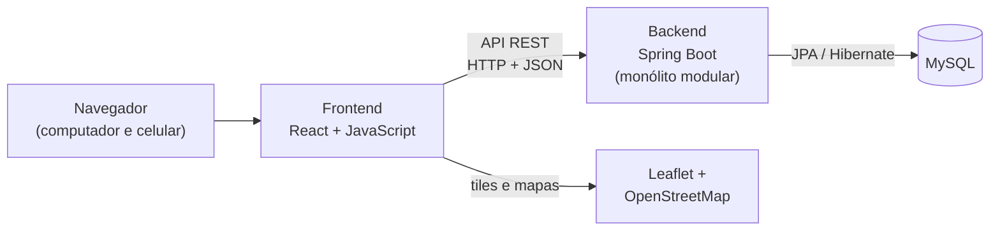

# HoopLink

**Plataforma web para o desenvolvimento de jovens atletas de basquete no Brasil.**

O HoopLink reúne em um só lugar as peneiras de clubes verificados, um mapa interativo de quadras e comunidades de jogadores ligadas a cada quadra. O lançamento piloto está previsto para a Região Metropolitana de Belo Horizonte (RMBH), com arquitetura pensada para expansão nacional.

> **Status:** planejamento concluído. A implementação está prevista entre 26/10/2026 e 29/11/2026, em cinco sprints semanais.

---

## Sumário

- [Problema abordado](#problema-abordado)
- [Objetivos](#objetivos)
- [Funcionalidades previstas](#funcionalidades-previstas)
- [Público-alvo](#público-alvo)
- [Tecnologias previstas](#tecnologias-previstas)
- [Arquitetura](#arquitetura)
- [Estrutura do repositório](#estrutura-do-repositório)
- [Fluxo de trabalho](#fluxo-de-trabalho)
- [Equipe](#equipe)

---

## Problema abordado

O basquete tem menos alcance cultural e midiático no Brasil do que modalidades como o futebol. Por isso, jovens interessados no esporte têm dificuldade para encontrar oportunidades de desenvolvimento.

Hoje, as informações sobre peneiras (datas, locais, requisitos e inscrições) estão espalhadas por redes sociais, sites e grupos de mensagens. Esse cenário traz três consequências principais:

- **Acesso difícil às oportunidades.** O atleta precisa procurar em vários canais e pode perder prazos.
- **Risco de seletivas falsas ou desatualizadas.** Não existe um canal oficial e verificado, o que preocupa atletas e responsáveis.
- **Pouca conexão com a comunidade local.** Faltam informações sobre a conservação das quadras e um meio simples de encontrar outros jogadores e organizar partidas.

**Pergunta de pesquisa:** como uma plataforma digital pode facilitar o acesso de jovens jogadores de basquete no Brasil a oportunidades de desenvolvimento esportivo, como peneiras, quadras, partidas e comunidades, contribuindo para sua evolução e permanência na modalidade?

## Objetivos

### Objetivo geral

Desenvolver uma plataforma digital que facilite o acesso de jovens jogadores de basquete no Brasil a oportunidades de desenvolvimento esportivo. A plataforma permitirá divulgar e localizar peneiras, quadras e atividades da modalidade, além de promover a interação e a formação de comunidades entre os praticantes.

### Objetivos específicos

1. Identificar as principais dificuldades de jovens jogadores no acesso a oportunidades de desenvolvimento esportivo.
2. Levantar informações sobre clubes, peneiras, projetos esportivos e demais oportunidades do basquete no Brasil.
3. Desenvolver a divulgação e a consulta de peneiras, com data, local, requisitos e período de inscrição.
4. Desenvolver um mapa interativo para localizar quadras de basquete próximas ao usuário.
5. Permitir que os usuários avaliem e comentem as quadras cadastradas.
6. Criar comunidades vinculadas às quadras, para a interação entre jogadores e o compartilhamento de informações.
7. Desenvolver a organização e a divulgação de partidas entre os usuários.
8. Aproximar jovens jogadores, clubes e comunidades de basquete por meio da plataforma.
9. Avaliar a usabilidade e a efetividade da solução diante das necessidades identificadas na pesquisa.

## Funcionalidades previstas

| Módulo | O que o usuário poderá fazer |
| --- | --- |
| **Conta e perfil** | Criar conta por tipo de perfil (atleta, clube, gestor de arena, organizador). Manter o perfil esportivo (posição, altura, data de nascimento). Atletas menores de 18 anos se cadastram com os dados e o consentimento do responsável |
| **Clubes** | Cadastrar o clube com CNPJ ou registro. O responsável convida os técnicos. O clube tem um perfil público com os contatos oficiais |
| **Peneiras** | Os clubes cadastram peneiras, que só são publicadas após a validação da administração, com selo de verificação. Os atletas buscam por cidade, categoria, data e clube, fazem a inscrição e recebem um comprovante. Os técnicos gerenciam e exportam a lista de inscritos |
| **Quadras e arenas** | Mapa interativo com as quadras próximas. Detalhes, fotos, avaliações e comentários de cada quadra. Usuários cadastram quadras públicas, sujeitas à aprovação. Arenas privadas divulgam horários e preços e recebem reservas |
| **Comunidade** | Comunidade por quadra, com entrada livre ou com aprovação. Mural de avisos e comentários, em que só os membros publicam |
| **Partidas e torneios** | Criar partidas informais ("rachas") com vagas, confirmar presença e ver os participantes. Divulgar torneios no mural das quadras |
| **Engajamento** | Feed com peneiras, partidas e publicações. Notificações na plataforma |
| **Governança** | Denúncia de conteúdo. Painel de administração para validar peneiras e quadras e para moderar usuários e conteúdos |

**Fora do escopo do MVP:** pagamento online de reservas, inscrição interna em torneios e avaliação de quadras por perfis que não sejam de atleta.

## Público-alvo

| Perfil | Necessidade principal |
| --- | --- |
| Jovem atleta | Encontrar peneiras confiáveis, quadras bem conservadas e pessoas para jogar |
| Técnico ou recrutador de clube | Divulgar seletivas oficiais e organizar os inscritos |
| Responsável por atleta menor de idade | Ter segurança de que a peneira e o clube são verificados |
| Gestor de arena privada | Ocupar horários vagos e chegar ao público do basquete |
| Organizador de torneios amadores | Divulgar campeonatos para os times da região |

## Tecnologias previstas

| Camada | Tecnologia | Uso |
| --- | --- | --- |
| Frontend | [React](https://react.dev/) com JavaScript | Interface web responsiva, construída com componentes reutilizáveis |
| Mapas | [Leaflet](https://leafletjs.com/) e [OpenStreetMap](https://www.openstreetmap.org/) | Mapa interativo de quadras, com marcadores e geolocalização |
| Backend | Java com [Spring Boot](https://spring.io/projects/spring-boot) | API REST, regras de negócio e validação de dados |
| Persistência | Spring Data JPA e Hibernate | Mapeamento das entidades e acesso ao banco |
| Segurança | Spring Security | Autenticação e controle de acesso por perfil |
| Banco de dados | [MySQL](https://www.mysql.com/) | Armazenamento relacional dos dados da plataforma |
| Testes da API | [Postman](https://www.postman.com/) | Verificação dos endpoints, das requisições e das respostas |
| Versionamento | Git e GitHub | Controle de versão e histórico do projeto |

O Docker Compose poderá ser adotado mais tarde, caso seja necessário padronizar o ambiente de desenvolvimento.

## Arquitetura

O HoopLink segue uma arquitetura cliente-servidor em três camadas: apresentação, aplicação e dados. O backend é um **monólito modular**: os módulos funcionais (contas, clubes, peneiras, quadras, comunidade, partidas e administração) ficam organizados dentro de uma única aplicação.



## Estrutura do repositório

```text
Hooplink/
├── backend/      # API REST em Java + Spring Boot (a ser criada)
├── frontend/     # Aplicação web em React + JavaScript (a ser criada)
├── .gitattributes
├── .gitignore
└── README.md
```

## Fluxo de trabalho

O desenvolvimento seguirá o Product Backlog do projeto (itens PB01 a PB34), organizado em sprints semanais.

**Branches**

| Branch | Uso |
| --- | --- |
| `main` | Versão estável, usada nas entregas |
| `develop` | Integração das funcionalidades da sprint em andamento |
| `feature/PBxx-descricao-curta` | Uma branch por item do backlog, por exemplo `feature/PB13-inscricao-peneira` |

**Commits:** mensagens curtas, no imperativo, citando o item do backlog. Exemplo: `PB13: adiciona geração de comprovante de inscrição`.

**Integração:** cada branch de funcionalidade entra na `develop` por pull request revisado pelo outro integrante. Ao fim de cada sprint, a `develop` é integrada à `main`.

## Equipe

| Integrante | Papel |
| --- | --- |
| Gabriel Lucas Rosa Raposo | Desenvolvimento |
| Guilherme Emanuel Martins Moreira Gonçalves | Desenvolvimento |

**Orientador:** Prof. Humberto Fernandes Villela

---

Projeto desenvolvido para a disciplina **Projeto de Inovação Tecnológica I** da **Faculdade COTEMIG**, Belo Horizonte, 2026.
